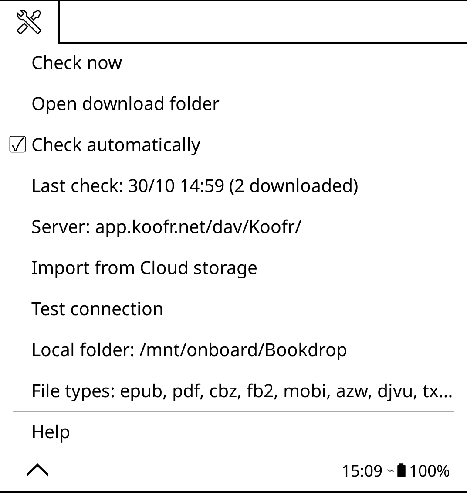

# bookdrop.koplugin

**Book Drop** (*Boîte de dépôt*) is a drop box for books for
[KOReader](https://github.com/koreader/koreader).

Put EPUBs (or any book KOReader opens) into a folder of a WebDAV server from
your phone or computer, whenever you like. The next time the reader is
online, it fetches them on its own, saves them on the device and removes them
from the drop folder. The drop folder only ever holds what has not been
fetched yet.



## Features

- **Automatic** — checks shortly after startup and whenever Wi-Fi connects,
  at most every 5 minutes. Never turns Wi-Fi on, never asks for it.
- **Check now** — a manual check from the menu, with a report and an
  *Open folder* button.
- **Never loses a book** — a book is removed from the drop folder only once
  the complete file is safely on the device (see below).
- **Any WebDAV server** — Koofr (free, recommended), Nextcloud, ownCloud,
  Synology, Apache/nginx WebDAV…
- **Import from Cloud storage** — reuse a WebDAV account already set up in
  KOReader's own Cloud storage.
- **Test connection** — clear messages for a wrong password, a wrong
  address, a missing folder (created for you) or a network problem.
- **File types** — only books are fetched (default: epub, pdf, cbz, fb2,
  mobi, azw, djvu, txt, html, docx); everything else stays on the server.
- French, Spanish and German translations.

## Installation

Copy the `bookdrop.koplugin` folder into KOReader's `plugins/` folder
(Kobo: `koreader/plugins/`, Kindle: `/mnt/us/extensions/`), or install it
with the Plugin Manager, then restart KOReader. The menu is under
**Tools → Book Drop**.

## Setup with Koofr (free, about 5 minutes)

[Koofr](https://koofr.eu) is a European cloud storage with a free 10 GB plan
and WebDAV access.

1. **Create an account** at <https://koofr.eu> (free plan).
2. **Create an app password**: in the Koofr web app, open
   *Preferences → Password*, and under *App passwords* generate one (name it
   e.g. "KOReader"). Copy it — it is shown only once. Use this, not your
   account password.
3. **On the reader**: *Tools → Book Drop → Server*:
   - tap **Koofr** to fill in the address `https://app.koofr.net/dav/Koofr/`,
   - username: your Koofr e-mail address,
   - password: the app password,
   - drop folder: `Bookdrop` (default).
4. **Test connection**. If the `Bookdrop` folder does not exist yet, it is
   created for you.
5. **Drop books**:
   - **Phone**: install the Koofr app, log in, then from any app (browser,
     mail, file manager) *Share → Koofr* and pick the `Bookdrop` folder.
   - **Computer**: open <https://app.koofr.net>, go into `Bookdrop`, and
     drag the files onto the page (or use the Koofr desktop app, which syncs
     a local folder).

That's it: the books appear in `Bookdrop` on the reader (by default
`<home folder>/Bookdrop`) the next time it is online.

### Nextcloud / ownCloud

- Address: `https://your.server/remote.php/dav/files/USERNAME/`
- Username: your Nextcloud user name
- Password: an app password (*Settings → Security → Devices & sessions →
  Create new app password*)

### Other servers

Any WebDAV server works: use the address of the WebDAV root (or of any
folder you can write to) and the drop folder name relative to it. Nested
names such as `Books/Inbox` are fine.

## How a check works

1. List the drop folder (`PROPFIND`, depth 1). If it does not exist, create
   it (`MKCOL`).
2. Ignore subfolders, empty files, files of other types, and files modified
   less than 30 seconds ago according to the server's clock (an upload may
   still be in progress; they are fetched next time).
3. Download each book to `<name>.part` in the local folder, then check it:
   - the byte count matches the size the server listed **and** the
     `Content-Length` of the download;
   - EPUB / CBZ / DOCX (and other ZIP containers): starts with a ZIP header
     and has its end-of-central-directory record;
   - PDF: starts with `%PDF-` and has an `%%EOF` marker near the end.
4. Rename to the final name. If a file of that name already exists, it is
   kept and the new one becomes `Name (2).epub`, `Name (3).epub`… Nothing
   is ever overwritten.
5. Only then, `DELETE` the remote file.

If a download is interrupted or incomplete, the `.part` file is removed,
the remote file is left alone, and it is tried again next time. If a
complete download is not a valid book (e.g. a damaged EPUB), it is left on
the server and skipped until it is replaced. If the `DELETE` fails, the
book is remembered as fetched (by name, size and ETag) so it is not
downloaded again, and the `DELETE` is retried at the next check.

Remote names are made safe before writing: path separators, `..`, control
characters and characters FAT32 refuses (`: * ? " < > |`) are replaced or
removed; UTF-8 names (accents, spaces…) are kept as they are.

## When does it check, and why not while reading?

- **At startup / when you come back to the file browser**: 5 seconds
  after the file browser appears, if the device is already connected.
- **When Wi-Fi connects** (KOReader's `NetworkConnected` event).
- **At most every 5 minutes** for automatic checks, and never two checks at
  once. *Check now* ignores the 5-minute limit.

Automatic checks are **deferred while a book is open**: they run when you
are back in the file browser. KOReader runs plugins on its single UI
thread and network transfers block it, so a 20 MB PDF on a slow
connection would freeze page turns for many seconds in the middle of your
reading — for books you were not going to open before closing the current
one anyway. A drop box is asynchronous by nature; waiting until you leave
the book costs nothing. *Check now* still works while reading.

During an automatic check, small books (under 1 MB) arrive without any
popup; larger ones show a short "downloading" message. At the end a
toast says "2 new books in Book Drop", and the file browser is refreshed
if it is showing the Book Drop folder. Errors during automatic checks are
silent (logged, and shown under *Last check* in the menu).

After a refused login, or when the server blocks connections for a while
(HTTP 429, "too many attempts"), automatic checks pause: retrying with the
same password would only extend the block. They resume as soon as the
server settings are changed (or imported) or a *Check now* / *Test
connection* succeeds.

## Settings

| Setting | Default |
|---|---|
| Server, username, password | — |
| Drop folder on the server | `Bookdrop` |
| Local folder | `<home folder>/Bookdrop` |
| File types | epub, pdf, cbz, fb2, mobi, azw, djvu, txt, html, docx |
| Check automatically | on |

Settings live in `koreader/settings/bookdrop.lua`. The password is stored
there in plain text, as KOReader's own Cloud storage does — use an app
password you can revoke.

## Limitations

- Transfers are synchronous: a large book blocks the file browser while it
  downloads (a message is shown).
- Only the top level of the drop folder is fetched.
- `.azw3` is not in the default list because KOReader does not open it;
  add it under *File types* if your build does.

## Development

Pure logic (PROPFIND parsing, URL decoding, file names, ZIP/PDF checks,
bookkeeping, throttling) is in `bookdrop_logic.lua` and specced with busted:

```bash
busted --output=plainTerminal
```

`bookdrop_sync.lua` holds the WebDAV client and the check itself, with its
libraries passed in, so it runs unchanged in KOReader and in a test driver.

## License

GPL-3.0, see [LICENSE](LICENSE).
